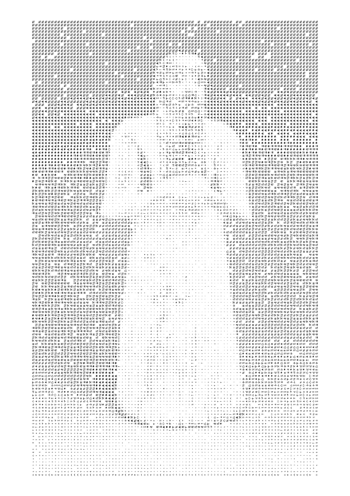
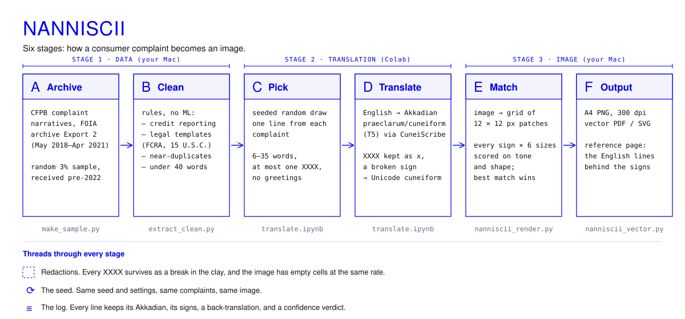
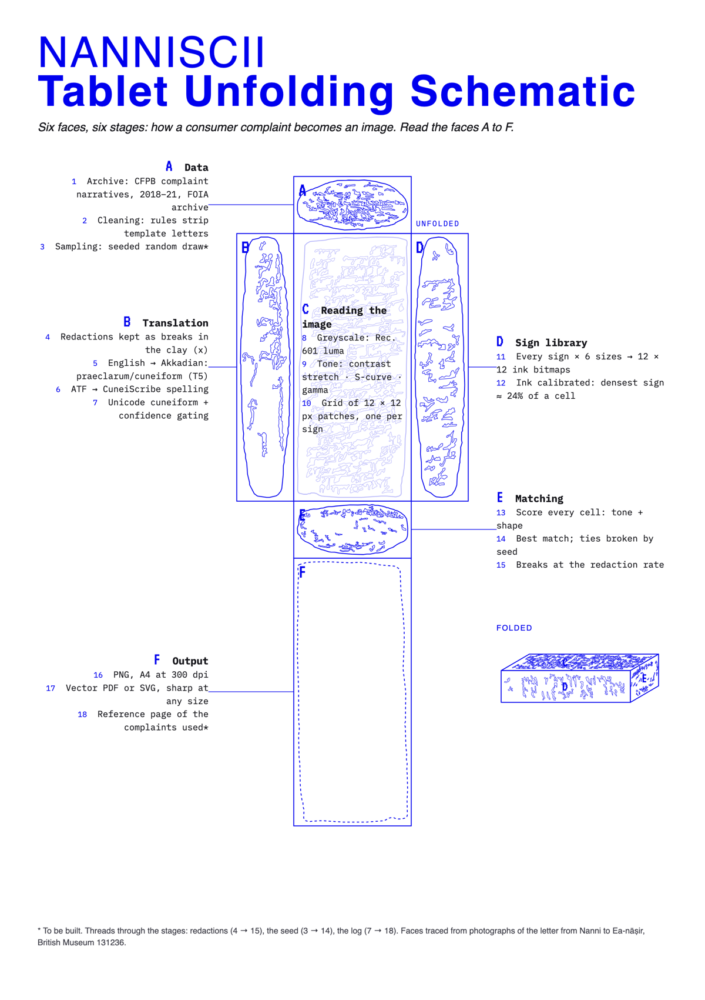

<div align="center">

# NanniSCII

### The Tablet Talks Back · Inference and the Human Archive

*Tessa Edwards · 2026*



<sub>First render, drawn with the signs of the four test translations. The full run follows.</sub>

</div>

Around 1750 BC, a man called Nanni pressed a complaint into clay. The copper he'd been sold was poor quality, his messenger had been sent away empty-handed, and he was not going to stand for it. His tablet, now in the British Museum, is often called the oldest customer complaint in the world.

NanniSCII sends modern complaints back the other way. Real grievances from the archive of the US Consumer Financial Protection Bureau are translated by a machine into Akkadian, Nanni's language, converted into cuneiform signs, and used as the alphabet of an image. The machine has no word for an overdraft fee, so the details fall away and the exasperation stays.

The project has three parts:

| Part | |
|---|---|
| **i · [The Tablet Talks Back](essay/the-tablet-talks-back.md)**<br>*Essay* | How human expression becomes computational representation, and how representation can in turn become a mechanism of influence. Machines can now map the latent representations of human cognition across the whole archive we've built, a vantage point no human can reach. [Read it](essay/the-tablet-talks-back.md) · [Artist statement](essay/artist-statement.md) · [Designed PDF](essay/The_Tablet_Talks_Back.pdf) |
| **ii · [The NanniSCII Generator](generator/)**<br>*ASCII art generator* | Translates excerpts from a modern database into an image drawn in ancient Akkadian cuneiform. The tablet as a vessel of social reflexivity: context, meaning and form transmuted into a digital artefact. [How to use it](generator/#make-an-image) |
| **iii · [Cuneiform Drift](extension/)**<br>*Browser extension* | A digital mnemonic. A cuneiform particle overlay that now and then melts the text you're reading into a clay sign, then heals. A trinket from the past, reminding us of our passive exchange with the living digital archive. [Install it](extension/#install-about-2-minutes) |

---

## How it works



Every XXXX redaction survives as a break in the clay. Each line keeps a log of its Akkadian, its signs, and a back-translation: what the machine thinks it wrote.

| They wrote | The machine read back |
|---|---|
| They charged me an overdraft fee even though I had money in my account. | As soon as they have brought the silver into my possession, they shall return the money tenfold to its owners. |
| Why am I being treated with such contempt after paying on time for years? | Why, for years, against me, against me, for years, I, I, I, |

*From the translation tests, on lines written in the CFPB style. The lines in the finished work are listed in [the data](data/).*

More in [the generator](generator/), [the data](data/) and [the research notes](research/).

<details>
<summary><b>The tablet unfolded</b>: the same six stages as the six faces of a tablet</summary>
<br>

</details>

## Quick start

**Try the extension.** [Download the zip](extension/cuneiform-drift.zip?raw=1), unzip it, open `chrome://extensions`, turn on *Developer mode*, click *Load unpacked*, and choose the folder. [Full instructions](extension/).

**Make an image.**

```bash
git clone https://github.com/dead-tom/NanniSCII.git
cd NanniSCII
python3 -m venv .venv && source .venv/bin/activate
pip install -r requirements.txt
python3 generator/nanniscii_render.py "generator/images/Standing_male_worshiper_high_contrast.jpg"
```

This draws the worshipper with the translated lines in `data/translations.csv` (until the full run is in, add `--text-csv research/results/step2b_results.csv`). Swap in your own photo; to translate new complaints, see [the generator](generator/).

## What's in here

```
essay/        the essay, the artist statement, the designed PDF
generator/    the scripts and the Colab notebook, from archive to image
extension/    Cuneiform Drift, the browser extension
data/         the lines used, with their translations
research/     the process: tests, results, decisions
images/       artworks, diagrams, process pictures
```

## Credits

- **Nanni's tablet:** UET V 81, British Museum 131236. English translation by A. Leo Oppenheim, *Letters from Mesopotamia* (1967).
- **Complaints:** US Consumer Financial Protection Bureau, Consumer Complaint Database, narratives archive (Export 2).
- **Translation:** [`praeclarum/cuneiform`](https://huggingface.co/praeclarum/cuneiform), a Sumerian and Akkadian translation model by praeclarum (MIT licence), run through [CuneiScribe](https://pypi.org/project/cuneiscribe/) 0.2.0.
- **Matching:** after Xu, Zhang and Wong, *Structure-based ASCII Art*, SIGGRAPH 2010.
- **Source photograph:** *Standing male worshipper*, Tell Asmar, c. 2900–2600 BC. The Metropolitan Museum of Art, 40.156, Fletcher Fund 1940; public-domain image.
- **Fonts:** [Noto Sans Cuneiform](https://fonts.google.com/noto/specimen/Noto+Sans+Cuneiform) and [Turret Road](https://fonts.google.com/specimen/Turret+Road), both SIL Open Font License.

## Licence

Code (generator, extension, research scripts): [MIT](LICENSE). Writing and images: [CC BY-NC 4.0](LICENSE-CONTENT), share with credit, not for commercial use. Fonts: SIL Open Font License. The complaint lines are from a US government archive.
