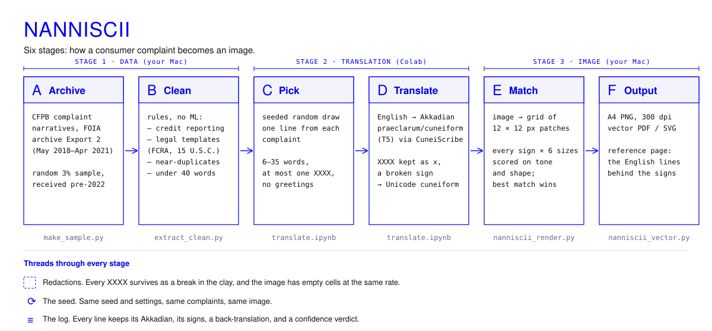

# The data

## Source

The **US Consumer Financial Protection Bureau's Consumer Complaint Database**: complaints from the public about banks, lenders and credit providers. Narratives were published only with the consent of the people who wrote them, and the Bureau scrubbed every personal detail, replacing names, dates, amounts and places with `XXXX`.

Since 14 September 2026 the narratives are no longer in the public database; they survive in the Bureau's [FOIA Reading Room archive](https://www.consumerfinance.gov/foia-requests/foia-electronic-reading-room/cfpb-consumer-complaint-database-narratives-archive/). This project uses **Export 2** (complaints received May 2018 – April 2021), and only complaints received before 2022, before large language models could write them.

## What's here

> **Coming next:** the first full run of the translation step. Until then, the test translations are in [`research/results/step2b_results.csv`](../research/results/step2b_results.csv).

| File | What it is |
|---|---|
| `translations.csv` | the lines used, one per complaint, with their full translation log |
| `reference.md` | the same lines in English, as a readable list |

**What's not here:** the raw archive and the cleaned sample (`data/raw/`) stay on the computer they were made on. Even anonymised, they are people's own words in bulk. Only the single lines used in the work are published, each with its complaint ID so it can be traced in the archive.

## From archive to lines

1. **Sample:** a random 3% of Export 2's narratives received before 2022.
2. **Clean, by rule:** remove *credit reporting* complaints (dominated by credit-repair templates), narratives citing legal template markers (15 U.S.C., FCRA, 1681, Fair Credit Reporting Act, section 604/609/611), near-duplicates, and anything under 40 words.
3. **Pick:** complaints drawn at random with a fixed seed (`SEED = 1`), one line from each: 6 to 35 words, at most one redaction, not a greeting.
4. **Translate:** each line into Akkadian, then into cuneiform, with every redaction kept as a break.

## `translations.csv` columns

| Column | |
|---|---|
| `n` | order drawn |
| `complaint_id`, `date`, `product` | from the archive: the complaint's ID, date received, and product category |
| `english` | the line, exactly as written (redactions included) |
| `akkadian_raw` | the model's output, in scholarly CDLI spelling |
| `akkadian` | the same, converted to CuneiScribe's spelling |
| `back_translation` | the model translating its own Akkadian back into English: what the machine thinks it wrote |
| `cuneiform` | Unicode cuneiform; `[x]` marks a redaction break |
| `n_signs`, `gaps` | number of signs, number of breaks |
| `sign_coverage_pct`, `unmapped` | share of syllables that became signs, and any that didn't |
| `validator` | CuneiScribe's confidence verdict: `render`, `render_with_caveat` or `fallback` |
| `odd_chars` | characters that made the validator fail, if any |
| `low_confidence` | `True` if the verdict wasn't `render` or coverage was under 90%: kept, and marked |

The translations are approximations made by a machine, not a scholar.
