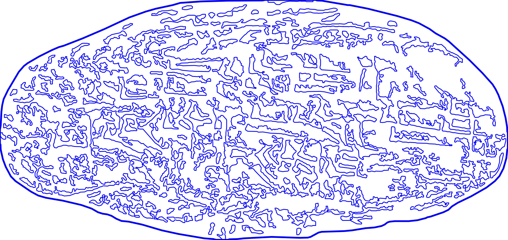

# The Tablet Talks Back

### Inference and the Human Archive

*Tessa Edwards · October 2026*

> **anachronism** (from the Greek ἀνά *ana*, 'against', and χρόνος *khronos*, 'time')

---

An anachronism is an object misplaced in time.

Examined outside its proper temporal domain, the Babylonian tablet crosses almost four thousand years of human communication into the paradigm of modern society as if through a wormhole. As Nanni pressed the familiar sentiment of customer dissatisfaction into clay, the grumblings of exasperation still resonate through epochs of civilisation, through the evolution of language itself, speaking directly to the collective human experience. Articulating the semantics of expression through language is fundamental in developing our human identity. Yet its true value is realised in our ability to construct interpersonal meaning from an accumulation of experience, for all the paradoxical complexities that entails. From reed stylus on clay to quill, printing press and computer, our tools have shaped modes of communication, societal infrastructures and our cognition. These tools have also enabled us to preserve and build vast records of living voices into an immortal archive of human thought and experience. Our tools have enabled us to document every complaint, confession, dream and desire, mapping a topology too immense and too intricate for any human mind to navigate.

Language is a symbolic examination of the experience of existence, an artefact that reveals our thoughts, values and desires. In *The Phenomenology of Spirit*, Hegel explores the role of language in the development of human cognition, and argues that language is not simply a tool for communication but rather a fundamental aspect of human thought and consciousness itself.

> *Language is living.*

The implications extend beyond the individual. As human expression is transferred into an increasingly interconnected digital archive, the boundary between human and machine begins to dissolve into a continuous exchange of data, inference and action. The more we contribute to the language, increasingly the models derive the representations and the resulting systems return to shape the environments in which we think, speak and behave. We are both the authors of this archive and the subjects of its analysis, participating in a feedback loop whose consequences we cannot yet fully comprehend.

Artificial intelligence in the form of machine learning has the ability to map almost the entire human corpus into a geometry of meaning. Rendering language as a high-dimensional vector space in which every word is defined in statistical relation to every other, it charts the terrain of our collective psyche far beyond the semantics. Machine learning has the vision to find connections between hidden variables in a shared latent manifold. Observed variables may look unrelated in a lower-dimensional projection, yet the bigger picture may reveal dependencies from our digital heritage that are interpretable. Anatomical machine analysis could expose our fundamental behavioural patterns as a species. For example, research shows that our psychological characteristics can be accurately predicted from our digital footprints; namely our online behaviour and the language we use. How much more could be inferred from an entire chronicle of human existence?

Multimodal AI is no longer a sophisticated "tool" but now functions as a forensic operative, an agent, capable of excavating symbolic artefacts from statistical residue that reveal more about our species and existence than we can even conceptualise. It's at this point that we now step into a new paradigm. Constellations of entangled representations of variables scattered across dimensions render the latent space simply unimaginable to humans. Hence the term black box: these are the new dark ages, where interpretability is a void.

The "AI for good" rhetoric is engineered as eventually serving humanity, where the future benefits of a shared abundance outweigh the present costs. We are promised that if we delegate our resources, entrust our credence and disclose our collective data now, we will yield the future benefits a hundredfold. The pledge echoes biblical stories of sacrifice and servitude to unseen deities. A scattering of genuine breakthroughs, such as DeepMind's AlphaFold, are held up as flagship cases, carrying the weight of solving global issues; curing cancer, resolving the climate crisis and redistributing wealth. Yet the same promise is used to justify unregulated development, eroding trust and accountability, as problems start to unfold.

We tend to speak of these costs as speculative, "as models become exponentially more powerful," as though this is a future scenario to be assessed and regulated when it arrives. But the juncture is already here. AI, an umbrella term that includes the industry itself as part of the domain, has already begun engineering societal structures, guiding the visibility of information and driving pathways for action with consequences that may extend beyond their intended objectives. Where variables are entangled, and correlations reveal dependencies that cannot be readily interpreted by human observers, the distinction between prediction and intervention becomes precarious. If behaviour can be modelled then it can be targeted and if it can be targeted, it can be influenced. What happens when that knowledge is operationalised by actors whose objectives may be exploitative, at scale?

As the interests of platform capitalism, corporate marketing and governmental control increasingly converge, psychographic analysis offers a means to anticipate, influence and potentially engineer human behaviour from forensic observation. The distinction between understanding a population and manipulating it becomes increasingly difficult to locate, particularly when the mechanisms through which these systems operate remain largely opaque and the domain remains largely unregulated. There is evidence that psychographic profiling, through powerful and complex algorithms that interpret our cognitive footprint, is already being used to shape our behaviour from the command line, whether for political or financial gain (Kosinski, Stillwell and Graepel, 2013; Matz et al., 2017). How well it works is still disputed (Eckles, Gordon and Johnson, 2018; Information Commissioner's Office, 2020; Perla et al., 2025), but as Bakir (2020) argues, the attempt alone is itself a form of coercion. Based on the evidence it's still hard to imagine the depths to which machine learning may understand us, part of the reason why it is often overlooked or dismissed entirely into the realms of sci-fi or conspiratorial supposition. This makes the bad news easy to ignore. The scenario has already begun to unfold in dangerous infringements of privacy and of autonomy. What's at stake may be the last and most important frontier of self-determination: privacy of thought.

Perhaps the most unsettling aspect of this transition is not that machines can learn to recognise something of ourselves in the language we leave behind, but that we have constructed systems capable of acting upon those representations. We have spent millennia developing increasingly sophisticated means of preserving our thoughts, extending our reach beyond the limits of memory and mortality. We are now confronted with the possibility that this accumulated record may become legible to forms of intelligence that operate beyond our own interpretative reach. We have built machines to interpret the archive, but the archive is also becoming a means through which machines interpret us.

The Babylonian tablet, once a vessel for the grievances of a dissatisfied customer, becomes an anachronistic mirror through which to examine this emerging relationship between human and machine. As a record of human expression surviving its author by four thousand years, the digital reincarnation of the tablet serves as a reminder that every artefact we have left behind contributes to a growing and living archive from which future systems may infer, predict and shape the conditions of human existence.

The artefact returns language to its origins, revealing how far the systems built upon it have travelled. An anachronism is an object misplaced in time. Perhaps the tablet was never misplaced at all, and it has simply arrived at the perfect moment of historical reflexivity.

**Four thousand years later, the artefacts have started to speak back.**

---

## The tablet

**UET V 81**, the complaint tablet to Ea-nāṣir. Clay, written c. 1750 BC in Akkadian cuneiform, found at Ur. British Museum, 131236.

It was sent to the copper merchant Ea-nāṣir in Ur by a dissatisfied customer, Nanni, complaining that the wrong grade of copper ore had been delivered after a Gulf voyage, and about the misdirection and delay of a further delivery. Slightly damaged; 23 + 25 + 3 + 2 lines.

Translation (Oppenheim, 1967)

> Tell Ea-nāṣir: Nanni sends the following message:
>
> When you came, you said to me as follows: "I will give Gimil-Sin (when he comes) fine quality copper ingots." You left then but you did not do what you promised me. You put ingots which were not good before my messenger (Sit-Sin) and said: "If you want to take them, take them; if you do not want to take them, go away!"
>
> What do you take me for, that you treat somebody like me with such contempt? I have sent as messengers gentlemen like ourselves to collect the bag with my money (deposited with you) but you have treated me with contempt by sending them back to me empty-handed several times, and that through enemy territory. Is there anyone among the merchants who trade with Telmun who has treated me in this way? You alone treat my messenger with contempt! On account of that one (trifling) mina of silver which I owe you, you feel free to speak in such a way, while I have given to the palace on your behalf 1,080 pounds of copper, and Umi-abum has likewise given 1,080 pounds of copper, apart from what we both have had written on a sealed tablet to be kept in the temple of Šamaš.
>
> How have you treated me for that copper? You have withheld my money bag from me in enemy territory; it is now up to you to restore (my money) to me in full.
>
> Take cognizance that (from now on) I will not accept here any copper from you that is not of fine quality. I shall (from now on) select and take the ingots individually in my own yard, and I shall exercise against you my right of rejection because you have treated me with contempt.

---

## References

*Bibliography to follow.*

<!-- Cited in the text: Bakir (2020); Eckles, Gordon and Johnson (2018); Hegel, The Phenomenology of Spirit;
     Information Commissioner's Office (2020); Kosinski, Stillwell and Graepel (2013); Matz et al. (2017);
     Oppenheim (1967), for the tablet translation; Perla et al. (2025). -->
