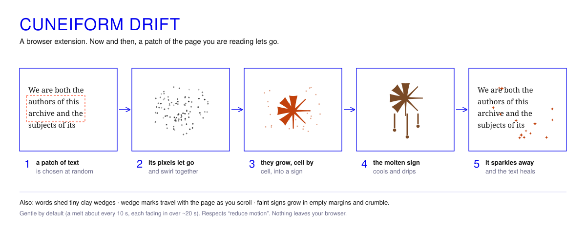

# iii · Cuneiform Drift

**Browser Extension Screen Decay** · Particle Overlay > Cuneiform Symbol Melt

A digital mnemonic: an Akkadian cuneiform particle overlay that subtly subverts the pixels on your screen into an animation. It's an ergonomic trinket from the past, gently reminding us to stay aware of our passive interchange with online interaction and the living digital archive. Like a bag charm, but for your computer.



---

## Install (about 2 minutes)

Works in **Chrome, Edge, Brave and Arc** on a computer. It isn't in the Chrome Web Store, so it's installed by hand:

1. **[Download `cuneiform-drift.zip`](cuneiform-drift.zip?raw=1)** and unzip it somewhere you'll keep it, for example `Documents/cuneiform-drift`.
2. Open **`chrome://extensions`** (Edge: `edge://extensions`).
3. Turn on **Developer mode** (top right).
4. Click **Load unpacked** and choose the unzipped `cuneiform-drift` folder.
5. Pin the wedge icon to your toolbar.

Open any normal website, click the wedge icon and press **Show me now** to see a melt straight away. After that it happens on its own.

> Keep the folder where it is: Chrome runs the extension from it. If you move or delete it, the extension stops.

## Using it

| | |
|---|---|
| **Presence** | How often it happens, from *Whisper* (a melt about every 18 s) to *Lively* (about every half second). The default is about every 10 s. |
| **Effects** | Turn each one on or off: **Text Melt** (text → molten sign → heal), **Word Shed** (a word lets go of a few clay wedges), **Motion Cues** (wedge marks at the screen edges as you scroll), **Margin Signs** (a faint sign grows in an empty margin and crumbles). |
| **Pause here** | Turns it off for the current website only. |
| **Alt + Shift + K** | Turns it on or off everywhere. |

It respects your system's *reduce motion* setting.

## Good to know

- **It doesn't work on Chrome's own pages** (new tab, settings, the Web Store) or in the built-in PDF viewer. Chrome blocks every extension there.
- **Privacy.** Nothing leaves your browser. The extension makes no network requests; the only file it loads is its own bundled font. Your settings are stored in Chrome's extension storage.
- **Why it asks to "read and change all your data on websites".** That is Chrome's standard wording for any extension that draws on top of web pages. It needs it to place the overlay; it doesn't read, keep or send what's on the page.
- **Updating.** Replace the folder with the new one, then press the reload arrow on the Cuneiform Drift card in `chrome://extensions`.
- **Removing.** Click **Remove** on the card in `chrome://extensions`, then delete the folder.

## Files

```
cuneiform-drift/
  manifest.json    extension settings (Manifest V3)
  drift.js         the particle layer: melt, shed, cues, margin signs
  content.js       starts drift.js on each page and loads the font
  background.js    keyboard shortcut, badge, starts in already-open tabs
  popup.html/.js   the settings panel
  settings.js      shared defaults
  fonts/           Noto Sans Cuneiform, Turret Road (both SIL Open Font License)
  icons/
```

Version 1.8.1.
