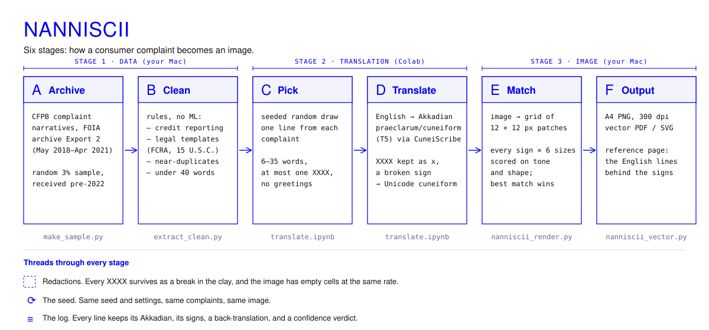
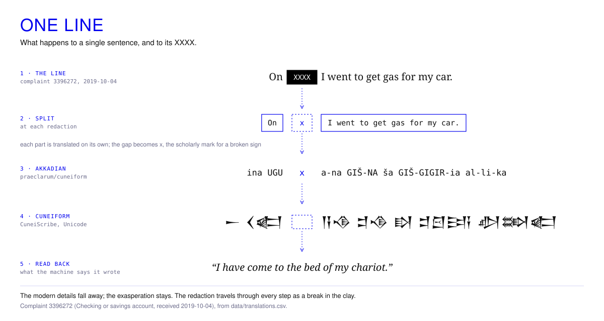
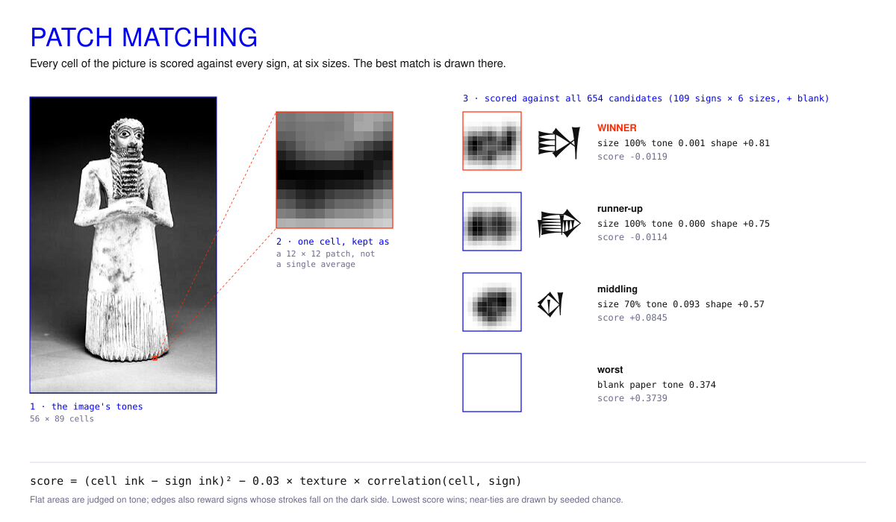

# ii · The NanniSCII Generator

**ASCII Art Generator** · Scrambled Complaints > Cuneiform Translation

Cuneiform was among humanity's first systematic translations of information into written form, turning quantities, objects and eventually language into repeatable marks: wedges pressed into clay. ASCII, standardised in 1963, did the same for machines, giving every character a number so that text could be stored in binary and passed between computers.

The generator runs that history backwards. Modern complaints are fed through a machine into synthesised reed-and-clay signs, as if through a wormhole back to Babylon, and those signs become the alphabet an image is drawn with.



---

## Make an image

You need Python 3.10+ on your computer, plus a free Google account for the translation step (it runs in Colab, because the model is large).

**Setup, once.** From the `NanniSCII` folder:

```bash
python3 -m venv .venv
source .venv/bin/activate
pip install -r requirements.txt
```

**1 · Sample the archive** (on your computer). Download *Export 2* from the [CFPB narratives archive](https://www.consumerfinance.gov/foia-requests/foia-electronic-reading-room/cfpb-consumer-complaint-database-narratives-archive/), then:

```bash
python3 generator/make_sample.py "path/to/CCDB_Export_2_May_2018_through_April_2021.zip"
python3 generator/extract_clean.py
```

This makes `data/raw/complaints_clean.csv`. The `data/raw/` folder never goes to GitHub.

**2 · Translate** (in Colab). Open [`translate.ipynb`](translate.ipynb) in [Google Colab](https://colab.research.google.com/), choose `Runtime → Change runtime type → T4 GPU`, then `Runtime → Run all`. Upload `complaints_clean.csv` when it asks. It downloads `translations.csv` and `reference.md`; put both in `data/`.

**3 · Render** (on your computer):

```bash
python3 generator/nanniscii_render.py "generator/images/Standing_male_worshiper_high_contrast.jpg"
python3 generator/nanniscii_vector.py "generator/images/Standing_male_worshiper_high_contrast.jpg"
```

Any photo works in place of the worshipper. Outputs go to `outputs/`:

| File | What it is |
|---|---|
| `outputs/ascii/<name>_nanniscii.png` | the artwork, A4 at 300 dpi |
| `outputs/ascii/<name>_nanniscii_tones.png` | the darkness the signs are matching (for checking) |
| `outputs/vector/<name>_nanniscii.pdf` | the same artwork as a vector, sharp at any size (`--format svg` or `both` also available) |

The same settings and `--seed` always give the same image, in PNG and vector alike.

## Settings

| Option | Default | What it does |
|---|---|---|
| `-w`, `--width` | `90` | signs across the page; `56` gives bigger, more legible signs |
| `--curve`, `--curve-mid` | `4`, `0.5` | contrast (S-curve strength and the tone it centres on) |
| `--ink` | `1` | overall darkness: above 1 darker, below 1 lighter |
| `--shape` | `0.03` | how much a sign's stroke direction counts against its tone (0 = tone only) |
| `--scales` | `1,0.85,0.7,0.55,0.42,0.3` | the sizes a sign may be drawn at |
| `--redaction` | `hole` | how XXXX breaks look: `hole` (empty cell), `x`, or `none` |
| `--invert` | off | light signs on black |
| `--size` | `auto` | `a4-portrait`, `a4-landscape`, `a3-portrait`, `a3-landscape` |
| `--seed` | `1` | same seed, same image |

Run any script with `--help` for the full list.

---

## How it works

**Translation.** Each line is translated by [`praeclarum/cuneiform`](https://huggingface.co/praeclarum/cuneiform), a T5 transformer trained on Akkadian, run through [CuneiScribe](https://pypi.org/project/cuneiscribe/), which converts the transliteration into Unicode cuneiform. Every XXXX redaction is lifted out before translation and put back afterwards as `x`, the scholarly mark for an illegible sign, so it survives as a break in the clay:



**Matching.** The renderer cuts the image into a grid. Each cell is kept as a small 12 × 12 patch rather than one average, so its edges and highlights survive. Every distinct sign from the translations is drawn at six sizes, and each cell is scored against every one of them, for tone (how much ink) and shape (whether the strokes fall where the cell is dark). The best match is drawn in that cell. This is patch matching, the technique behind *Structure-based ASCII Art* (Xu, Zhang and Wong, 2010).



The signs are not in reading order: the complaints are the image's alphabet, not text to be read within it. `data/reference.md` lists the English lines behind them.

## Files

| File | Step |
|---|---|
| `make_sample.py` | 1 · random 3% of the archive's narratives, read in chunks so it uses little memory |
| `extract_clean.py` | 1 · removes template letters by rule (see [the data](../data/)) |
| `translate.ipynb` | 2 · picks one line per complaint, translates it, logs everything (Colab) |
| `nanni.py` | the shared helpers: redactions, line picking, spelling fixes, checks |
| `nanniscii_render.py` | 3 · patch matching and the PNG |
| `nanniscii_vector.py` | 3 · the same layout as a vector PDF or SVG |
| `fonts/` | Noto Sans Cuneiform (SIL Open Font License) |
| `images/` | the source photo |

## Lineage

In *Computer Nude (Studies in Perception I)*, Leon Harmon, a researcher in cognitive neuroscience, and Ken Knowlton, a computer engineer at Bell Labs, scanned a photograph of the dancer Deborah Hay and rebuilt it as a mosaic of typographic symbols chosen by halftone density. It was printed in *The New York Times* on 11 October 1967 and shown in *The Machine as Seen at the End of the Mechanical Age* at MoMA from 25 November 1968. NanniSCII's first renderer worked the same way (a density ramp, see [the research notes](../research/)); the final one also matches shape.
