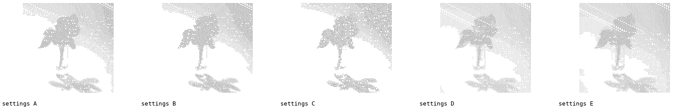
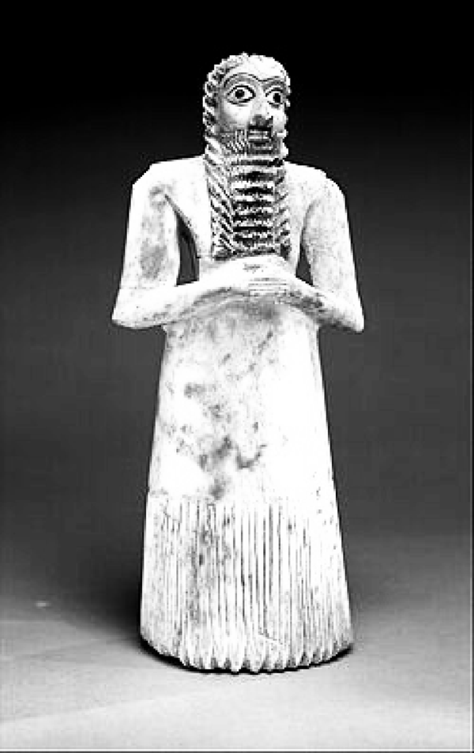
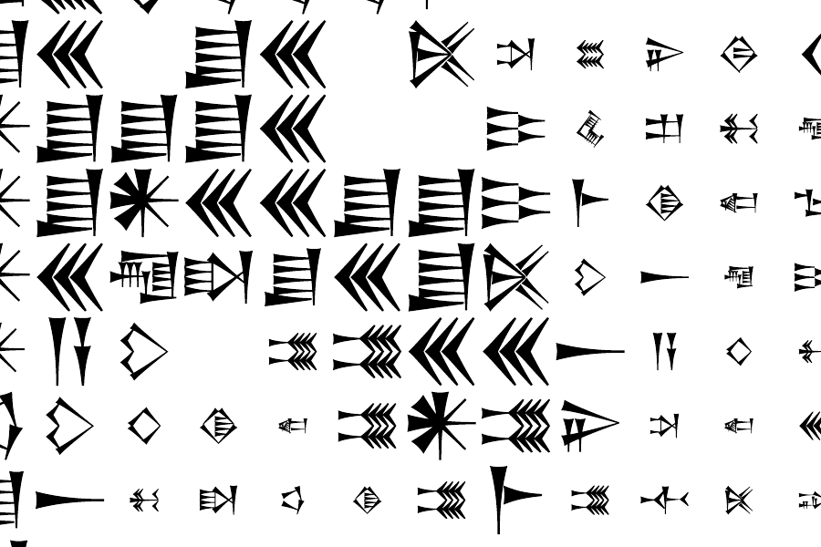

# Research and process

How NanniSCII was made, condensed from the project log (October 2026). The decisions are kept because they are part of the work.

---

## 1 · Finding the voices

The plan was to read complaint narratives from the CFPB's public Consumer Complaint Database. They weren't there.

- The website no longer showed narratives, and its "only show complaints with narratives" filter had gone.
- The API returned complaints, but with no narrative field. The CSV export had no narrative column either.
- **The reason:** on 14 August 2026 the CFPB announced it would stop publishing narratives, calling them unverified and one-sided (consumer groups opposed this). On **14 September 2026** it removed them and archived them in its [FOIA Reading Room](https://www.consumerfinance.gov/foia-requests/foia-electronic-reading-room/cfpb-consumer-complaint-database-narratives-archive/).

So the voices were withdrawn from the living public database weeks before this project began, and now exist only in an archive. *"Passed through the archive"* became literally true: the project is an excavation.

The archive blocks Google Colab, so Export 2 (May 2018 – April 2021) was downloaded in a browser and sampled on a laptop (`generator/make_sample.py`): read in chunks, a random 3% of narratives received before 2022. Pre-2022 is deliberate: written by people, before large language models.

## 2 · Choosing a translator

CuneiScribe's own trained model has not been released; its default is a placeholder (`google/byt5-small`, never trained on Akkadian). Three models were tested on three lines written in the CFPB style ([`notebooks/model_test.ipynb`](notebooks/model_test.ipynb), [results](results/model_test_results.csv)):

| Model | Result |
|---|---|
| `praeclarum/cuneiform` | **Pass.** The only one producing real Akkadian |
| `notninja/byt5-base-akkadian` | Fail. English sentences unrelated to the input ("Why have you taken a wife in marriage?") |
| `google/byt5-small` (control) | Fail, as expected: it repeated the prompt. This shows the test can tell good from bad |

praeclarum had two problems:

1. **Only ~76% of syllables became signs.** It writes the scholarly CDLI spelling (`_kug-ud_`, `sz`, `s,`); CuneiScribe expects `KUG-UD`, `š`, `ṣ`. A spelling conversion brought coverage to **100%**.
2. **"XXXX" sent it into a loop** (`x x x x …`). In scholarly notation `x` is an illegible sign, so it read the redaction as a broken tablet.

## 3 · Keeping the XXXX

Rather than delete the redactions, they are kept as breaks in the clay. Two methods were compared ([`notebooks/step2b_praeclarum_fixes.ipynb`](notebooks/step2b_praeclarum_fixes.ipynb), [results](results/step2b_results.csv)):

- **split**: translate the text around each redaction, put a broken sign `x` back in its place. **Worked.**
- **single**: replace the redaction with `x` and translate the whole line. Looped again; dropped.

| Line | What the machine says it wrote |
|---|---|
| "I have called them XXXX times and nobody will help me." | "I said to them: The days are long, nobody will agree to me." |
| "They charged me an overdraft fee even though I had money in my account." | "As soon as they have brought the silver into my possession, they shall return the money tenfold to its owners." |
| "Why am I being treated with such contempt after paying on time for years?" | "Why, for years, against me, against me, for years, I, I, I," |
| "On XX/XX/XXXX I paid {$XXXX} and XXXX bank still says I owe them." | "As to the … of the … of the …" |

The second line is the artist statement happening in practice: Akkadian has no word for an overdraft fee, so it became silver and debts. The fourth shows the limit: too many redactions chop a line into fragments with no context, so lines with more than one XXXX are not used.

**The concept held:** real translation, not a letter-for-letter cipher. The loss of meaning is the argument.

## 4 · Cleaning without machine learning

The first design used machine learning to remove template letters (TF-IDF → SVD → HDBSCAN, where *the noise is the humans*) and to score each sentence for desperation. That became the next project (see below). Here, simple rules are enough (`generator/extract_clean.py`):

1. has a narrative, received before 2022
2. not *credit reporting* (dominated by credit-repair templates)
3. no legal template markers (15 U.S.C., FCRA, 1681, Fair Credit Reporting Act, section 604/609/611)
4. no near-duplicates (first 300 characters compared)
5. at least 40 words

## 5 · Drawing with signs

The renderer went through three versions.

1. **Density ramp**, after the classic ASCII method ([`asciify.py`](asciify.py)): signs sorted by how much ink they use, dark areas get dense signs. It looked flat: even the densest sign covers only ~24% of its cell, so the mid-tones were nearly identical. Drawing lighter tones with smaller signs widened the range to about 30:1.
2. **Rebuilt from scratch.** Two problems found: the stripes came from each tone's signs repeating in a fixed order, and the photo's backdrop had a light fall-off. Random choice fixed the stripes; flattening the background removed the backdrop, which wasn't wanted.
3. **Patch matching (final).** Each cell kept as a 12 × 12 patch; every sign rendered at six sizes; every cell scored against every candidate for tone and shape; near-ties chosen at random with a fixed seed. After Xu, Zhang and Wong (2010).

*Settings tests on a rose, 16 October. B was chosen as the baseline (90 signs across).*

<table><tr>
<td width="33%"></td>
<td width="33%"></td>
<td width="33%"></td>
</tr><tr>
<td>source photo</td><td>the tones the signs are matching</td><td>vector output, zoomed</td>
</tr></table>

**Decisions:** aesthetics over readability (signs are not in reading order; the reference page holds the English); the whole photograph is the image, backdrop included; redactions appear as empty cells at the same rate as in the complaints.

## 6 · Picking and translating

`generator/translate.ipynb` draws complaints at random with a fixed seed and takes one line from each: 6–35 words, at most one redaction, no greetings. Each line is translated, converted and logged with its back-translation, sign coverage and CuneiScribe's confidence verdict. Low-confidence lines are kept and marked; a line that sends the model into a loop is replaced by another complaint.

Because patch matching uses the *set* of distinct signs, not one sign per cell, the lines become the image's alphabet. The run on 4 November 2026 translated 40 lines into 955 signs, **109 of them different** (the four test lines had 34); the worshipper at 90 signs across uses 12,800 of them. [The lines](../data/reference.md).

What survived translation is the argument in miniature. An overdraft fee became *"my silver is stolen, and my head is cut off"*; a trip to buy petrol became *"I have come to the bed of my chariot"*; BofA became a man called Bafâ, performing an extispicy on your property. Many lines collapse into repetition (*"in perpetuity, in perpetuity"*, *"to Nusku, to Nusku, to Nusku"*), the model's own exasperation.

---

## Parked for the next project

A **desperation score**: emotion classification (a transformer trained on GoEmotions, with VADER as a rule-based baseline) plus linguistic features (I/me/my, question marks, capitals, *never/nobody/always*), combined into a ranking of the most desperate line in each complaint. GoEmotions has no "desperation" label, so it would have to be built from proxies (sadness, fear, nervousness, anger, disappointment), which is the same move psychographic profiling makes (Kosinski, Stillwell and Graepel, 2013). Building it would mean doing the thing the essay warns about, which is the point of making it next.

## Known issues

- CuneiScribe 0.2.0's validator crashes on unexpected characters ("'set' object is not subscriptable"); the notebooks catch this and log the characters.
- The confidence check catches broken output, not wrong meaning: it did not flag "overdraft fee" as a modern concept.
